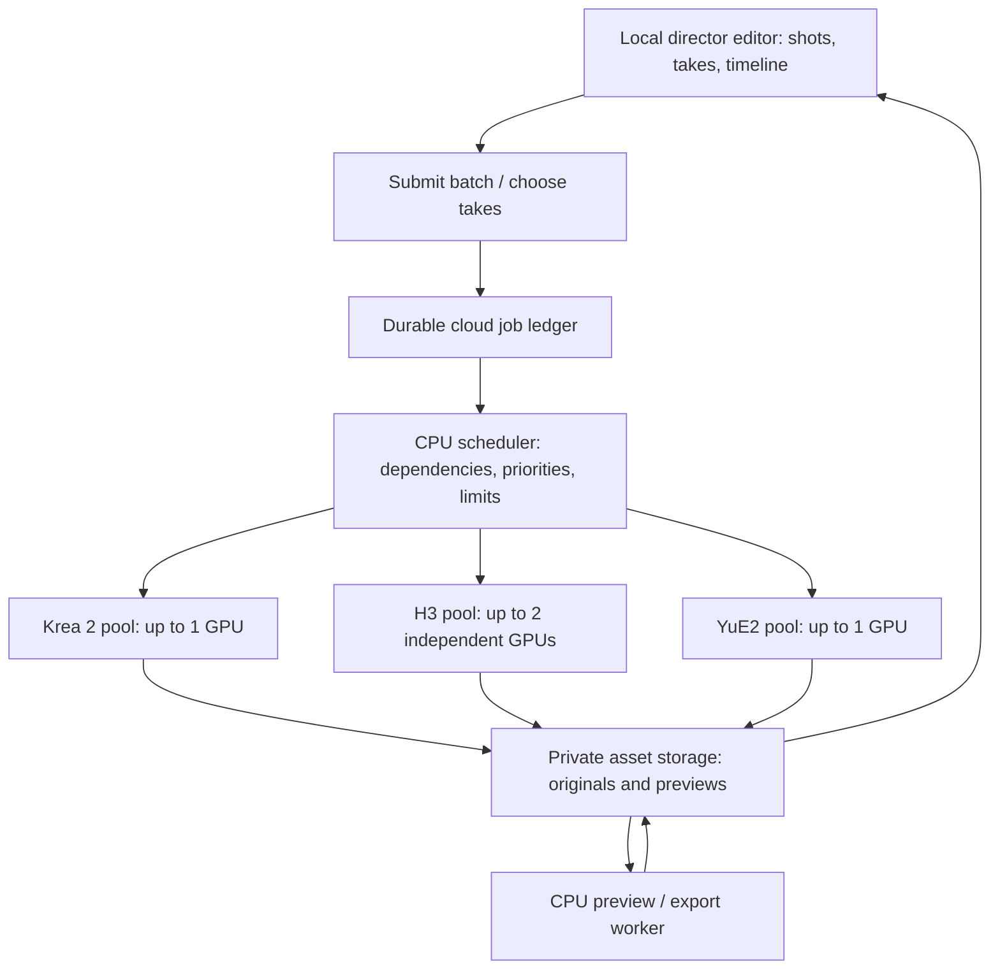

# Seed director studio: multiple models, LoRAs and batch rendering

> **Historical research:** retained as a September 2026 snapshot. For the latest
> direction, see the [RTX worker-pool analysis](2026-09-20-rtx6000-worker-pool.md)
> and [measured B200 findings](../development/2026-09-20-b200-live-validation.md).
> Prices, assumptions and recommendations below reflect the research dates.

September 19, 2026. Architecture recommendation only; no deployments, rentals or paid inference.

Follow-up: [Modal vs fal Serverless comparison](2026-09-19-modal-vs-fal-studio.md). fal supports private custom workflows too and is price-competitive; Modal remains the initial personal-studio choice based on self-service access and plan fit, not a demonstrated speed advantage.

## Intended use and decision

One person's studio, used for 3–4 hours a few times a week. Models: Krea 2 for images, MiniMax H3 for video/audio, and YuE2 for music. Bring private models and LoRAs, submit multiple requests together, review takes and edit a sequence. Preserve the existing accepted generation quality. A 15-second H3 clip taking up to roughly ten minutes is acceptable.

**Use a local editor with a small durable cloud batch service and separate Modal worker pools per model family.** The app owns shots, takes, selections, recipes and the timeline. ComfyUI remains an execution engine. GPU allocation is a backend detail, not a step required to submit work.

Start with caps of one Krea worker, two independent H3 workers and one YuE2 worker; these are ceilings, not four permanently rented GPUs. Each GPU executes one generation at a time initially. Keep only the actively used model warm. Queue compatible jobs consecutively, drain the batch, then release compute. A short render queue is useful work that can amortize a startup; ten minutes of human review alone is not.

## Proposed arrangement

Keep the current local TypeScript app and SQLite project library. Add a thin authenticated cloud API/dispatcher; a managed PostgreSQL job ledger is a practical small durable store. Use private S3-compatible object storage for uploaded references, outputs and manifests. Modal Volumes hold immutable base weights and adapter versions close to workers. Do not share the local SQLite file across concurrent cloud containers.

The cloud ledger is authoritative for execution; local SQLite is authoritative for local project editing and mirrors execution status. Project revisions and immutable selected asset IDs travel with the batch. This lets already-submitted work and automatic dependencies finish after the editor closes. User-selection dependencies intentionally remain paused until a take is chosen.

Modal supports asynchronous job submission and autoscaling. Its function results expire after seven days, so job history and original media must be stored independently. [Job processing](https://modal.com/docs/guide/job-queue), [autoscaling](https://modal.com/docs/guide/scale), [Volumes](https://modal.com/docs/guide/volumes).

## Worker strategy

| Pool | Initial execution approach | Hardware candidates | Lifecycle |
|---|---|---|---|
| Krea 2 | Existing pinned Comfy graph and private adapters | RTX PRO 6000 as known baseline; test a compatible 48GB GPU later | Retain while actively iterating images; drain image batches together |
| H3 | Existing Comfy graph, unchanged quality and reference handling | Benchmark one B300, B200 and H200 per worker | Up to two independent workers for queued takes; retain one only during active video iteration |
| YuE2 | Dedicated pinned Comfy runtime; use a separate adapter to official Python inference only if needed and validated | 24GB-class minimum candidate; 48GB gives headroom | Run music batches and shut down when finished |
| Media | FFmpeg/probe/thumbnail/waveform/proxy generation | CPU first | Short jobs; no expensive video-model GPU reservation |

Hardware assignments are candidates, not demonstrated ten-minute H3 or YuE2 performance on Modal. Krea's current INT8 kernels and private adapters must work on any cheaper GPU before moving it. More H3 workers improve batch completion time; they do not shorten an individual clip.

ComfyUI merged native YuE2 support on September 11. Seed's manifest/request schema currently contains no music route; native support alone does not validate a particular YuE2 LoRA loader. The official YuE2 package documents 24GB GPUs without quantization, but its timings are for that package, not Seed's Comfy worker. Keep its score/planning artifacts where available so later music edits have more information than a final waveform. [Comfy merge](https://github.com/Comfy-Org/ComfyUI/pull/16250), [official model card](https://huggingface.co/m-a-p/YuE2-3B).

The current model card lists CC BY-NC-4.0; record license metadata when registering YuE2. Personal ownership of the studio is not itself a conclusion about a particular use's license coverage. [Published license](https://huggingface.co/m-a-p/YuE2-3B/blob/main/LICENSE).

## Models and LoRAs are versioned recipes

Use a model/recipe registry instead of assuming every request is the current image/video mode:

- Model family and exact weight hashes, with variant such as H3 FL2VA or Ref2VA.
- Worker image digest, Comfy/node versions and tested hardware.
- Approved workflow template plus allowed inputs, outputs, duration and size.
- Encoder, VAE and precision choices; sampling and quality profile.
- Compatible LoRA formats and targets, maximum tested composition, recommended strengths and trigger text.
- Per-job ordered adapter list: ID, version/hash and strength.
- Input asset hashes, prompt, resolved seed, selected shot revision and output settings.

LoRAs should usually be request inputs applied to a reusable base-model worker. Cache their files; keep a bounded cache of patched model variants when safe. Group ready jobs by base variant and adapter combination, while preserving deadlines and dependencies. Never modify a shared model's adapters concurrently; reset or clone model state between different combinations.

Do not create a separate deployed endpoint or warm pool for every character, shot, prompt or LoRA strength. Modal class parameters create separate pools for distinct parameter combinations: reserve those parameters for a small set of base-model/runtime identities. Per-job adapter choices belong in the method input. [Parameter behavior](https://modal.com/docs/guide/parametrized-functions).

Style LoRAs, identity/edit adapters and acceleration adapters are different recipe changes. Not every file is interchangeable: H3 routes and functional Krea adapters can require different graph structure. YuE2 adapter formats may be specific to their training/inference extension. Expose only tested combinations; do not silently drop an incompatible adapter or alter precision to make a job fit.

Store new weights once, verify their hash, then atomically publish an immutable version. Workers read published versions; a separate preparation task handles downloads. GPU workers should not install nodes or download the entire model library for every job.

## What “send a batch” means

One user action submits a batch manifest. It expands into independently tracked jobs, each with its own seed, recipe and output. This is application batching; it does not require putting every request into one giant GPU tensor batch or one all-or-nothing provider invocation.

Example for a 60-second sequence:

1. Four shots with four Krea candidates each: 16 image jobs.
2. User chooses one candidate per shot.
3. Two 15-second H3 takes per selected shot: eight video jobs.
4. Two YuE2 music candidates can run independently of video unless their inputs require an approved edit.
5. CPU assembly produces a review cut from chosen takes, trim ranges and music; originals remain untouched.

One initial submission can express all stages, including waiting-for-selection gates. A “generate immediately” mode can execute dependencies automatically only when each downstream input is unambiguous; selecting the best candidate is a separate creative decision. Do not silently run H3 for every Krea candidate.

The batch API should:
- Validate/register all recipes and verify reference uploads before acknowledging durable acceptance.
- Resolve random seeds once and save the exact request snapshot.
- Return the batch ID immediately; jobs remain trackable and cancellable individually.
- Distinguish waiting for inputs/selection, queued, preparing a worker, generating, uploading, completed and failed.
- Persist successful outputs as each job finishes, so one failure does not discard the rest.
- Allow rerunning only failed jobs or a selected shot.
- Attach late results to their original take/revision; never replace a newer chosen take.
- Support a priority “current shot” request ahead of background alternatives without interrupting an in-progress expensive job by default.

## Scheduling and persistence

Keep scheduling on CPU. A task waiting for a parent output or a human choice should hold no GPU.

Store jobs and a dispatch outbox in one transaction. A dispatcher leases runnable jobs, assigns unique attempt IDs and records provider call IDs. Workers upload into attempt-specific paths, verify outputs, and publish completion through a compare-and-set update accepting only the current lease/attempt. Reconcile ambiguous provider responses before retrying.

Aim for idempotent submission and deduplicated accepted outputs, not a claim of exactly-once GPU execution. A crash after an external submission can still cause duplicate compute; track it and bound retries. Persist output manifests before a worker exits; provider completion is not equivalent to a file being durably available.

Global concurrency and cost controls must cover every model pool and base variant together. Start at four concurrent GPU jobs total (two H3, one Krea, one YuE2), with explicit job timeouts, bounded retries, a session expiry and cost estimates before dispatch. Stop admitting new jobs at the configured session budget, accounting for already-running jobs; cancellation may still incur charges until workers stop. These are controls to implement, not settings changed today.

## Warmth policy for a personal studio

**Batch work:** provision only for ready jobs, run several compatible jobs back-to-back, and scale down after a short grace period when the queue is empty. Keep the two H3 workers only while the backlog warrants both.

**Rapid iteration:** opening and actively using the shotboard can keep Krea warm; switching to video iteration can retain one H3 worker across review. The second H3 worker handles bursts. Music workers can normally scale down after their candidate batch.

**End session:** set all minimum worker counts to zero and let in-flight work follow the user's finish/cancel choice. An expiring session lease releases warm reservations if the editor disconnects.

Pre-stage model files and build dependencies before a session. Prewarm only the models needed by the submitted plan or actively selected tool. Measure allocation, model load and inference separately. The user's existing 20+ minute rental setup is not a measured Modal cold-start time; do not promise a first-ready time until it is tested.

## Batch economics

Illustration only: eight 15-second H3 attempts, each taking ten minutes on one B200. This preserves the user's latency target as an assumption, not a published benchmark.

| Arrangement | Generation wall time after workers are ready | Total GPU execution | Estimated execution cost |
|---|---:|---:|---:|
| One B200 worker | 80 min | 80 GPU-min | ~$9.61 |
| Two independent B200 workers | 40 min | 80 GPU-min | ~$9.61 plus additional startup overhead |

Includes GPU plus an illustrative four physical CPU cores and 96GiB RAM per worker during execution; excludes allocation/startup, idle, storage, transfer, control service, tax and image/music jobs. Real scaling can differ due to shared storage and other bottlenecks. [Modal rates](https://modal.com/pricing).

That is approximately $1.20 per video attempt before overhead. The old ~$21.62 figure reserved one B200 and that host allocation for all three hours; the batch example pays for 80 minutes of execution. Twelve such eight-video batches/month would be ~$115 in video execution, not a total studio subscription estimate. Keeping an image or video worker warm adds its time separately.

Batching amortizes loading and improves utilization. It does not inherently reduce the computation or change quality per clip. Two workers are useful because the user can review completed takes while the rest of the queue runs.

## Repository changes

Useful pieces already present:
- `server/jobs.ts`: submission IDs, per-job seeds, request snapshots, recovery and verified output download.
- `server/db.ts`: idempotent submissions and local job history.
- `worker/models.json`: pinned model files with hashes.
- Comfy graph builders and native output validation.

Changes needed:
1. Replace fixed live-worker capability checks at submission with validation against versioned recipe manifests. A valid batch must be accepted while zero GPUs are running.
2. Generalize `ImageRequest` into image/video/music jobs with recipe IDs and adapter lists. Current `Preset` is one fixed adapter; it is not a general LoRA registry.
3. Replace the single SSH `WorkerConnection` dispatch contract with an execution-provider adapter supporting submit/status/cancel and durable artifacts. Keep the current worker as a supported backend during migration.
4. Replace the global “no unresolved native job” condition with independent job claims and per-pool capacity. A failure in one model family must not halt unrelated jobs.
5. Split model preparation by family/route; Krea must not wait for both H3 checkpoints.
6. Add shots, takes, selections, generation recipes, batch dependencies and timeline references. Editing a prompt creates a new recipe revision rather than rewriting prior takes.
7. Make local downloads a synchronization step after cloud completion, so the PC's availability is not required to preserve results.

## Build order

1. **Batch execution foundation:** one Modal worker family using an existing validated Comfy graph; durable acceptance, results, retry/cancel and recovery with the editor closed.
2. **Multiple families and adapters:** Krea + H3, independent pools, per-job LoRAs, two concurrent H3 takes, cached weights, explicit quality comparisons. Add YuE2 after validating its graph and adapter format.
3. **Director workflow:** shotboard, take comparison/picking, dependent video batches, music candidates and a simple timeline with proxy preview/export. Preserve editable music planning artifacts when supported.
4. **Cost/latency tuning:** only after real telemetry, select the cheapest compatible GPU meeting each model's target, tune warm windows, and evaluate true inference batching separately.

The immediate architectural decision is one app-level queue with independently scalable model workers, not one permanently running GPU carrying every model. Implement the execution foundation before expanding the editing UI.
