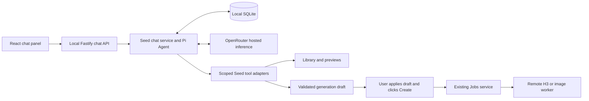

# Seed chat through OpenRouter and Pi

Research and architecture proposal, 12 September 2026 (America/Chicago). Not an implementation or deployment decision. Inspected Seed commit `42aedec37a6297b9c3cc19bcf1676c38e6b561ba`. No paid inference, generation, installation, rental, or deployment was performed.

**Recommendation:** add a persistent chat panel to Seed, run Pi's TypeScript agent runtime inside the local Node server, and send inference to OpenRouter. Try standard Gemma 4 31B first, with standard Grok 4.20 as a manual alternative. Begin with image discussion, prompt preparation, Library lookup, and reviewable generation drafts. Keep existing Create and job controls responsible for paid generation.

The owner's observation that standard Gemma rarely refuses their actual prompts is a good reason to test it first. The older Heretic/abliterated research in this directory is historical context, not the requirement for this exploration. “Standard weights” and “reasoning disabled” are different choices: standard Gemma can use its thinking mode.

## What exists in Seed

The installed [Seed skill](../../skills/seed/SKILL.md) and `studio/CURRENT-DIRECTION.md` describe one local package, remote GPU generation, local permanent media, and CLI-operated infrastructure. I also read `studio/DEVELOPMENT.md`; no AGENTS.md was found in the checked worktree or checked ancestor locations.

| Existing location | Relevant behavior and proposed use |
| --- | --- |
| `web/main.tsx` | React Generate/Library shell; workflow drafts in localStorage; polling for jobs/studio state. Add a chat panel at the shell level so navigation does not discard it. |
| `web/gallery-picker.tsx`, `web/references.tsx`, `web/uploads.ts` | Library selection, references, resumable uploads. Extend the picker with an explicit chat attachment mode; its current edit/video selection rules are not a generic attachment contract. |
| `web/spicy-mode.tsx` | Session-scoped Standard/Spicy presentation. Apply the same visibility rules to chat attachments and conversation previews. |
| `server/http.ts` | Fastify routes, same-origin/Host checks, self-only CSP, 16 KiB default JSON body limit. Register separate chat routes; keep browser traffic same-origin. |
| `server/db.ts`, `server/storage.ts` | SQLite WAL, migrations through v3, permanent per-user data outside installation. Add chat tables through a migration. |
| `server/jobs.ts` | Submission validation, capability checks, serialization, idempotency keys, reconciliation and recovery. Reuse this generation path. |
| `server/workflows.ts`, `server/video.ts` | Validated image/video requests and authored Comfy graphs. Agent drafts must satisfy these contracts; never accept model-authored graphs. |
| `server/media.ts`, `server/previews.ts`, `server/sequences.ts` | Validated local assets, previews and frame sequences. Resolve attachment IDs server-side and reuse bounded previews. |
| `server/credentials.ts`, `server/cli.ts` | Masked setup, atomic private credential file writes, filtered environment for the server. Add a dedicated OpenRouter credential path without requiring GPU setup for chat. |
| `prompting/` | Authored image/video instructions, including H3 scene, dialogue and sound fields. Package selected instructions as versioned resources for prompt preparation. They are not currently included in package.json's shipped file list. |

Image-to-image appears in UI/shared workflow definitions but is absent from the actual validated submission union; identity editing is documented unfinished. The chat agent must advertise actual capabilities, not everything named in the UI.

Using the supplied 95.59 GiB usable VRAM and 68 GiB H3 planning budget leaves 27.59 GiB arithmetically. That is not a safe promise of LLM capacity: weights, KV cache, vision encoding, workspaces and generation peaks all matter. Hosted chat allocates no inference memory on the rented GPU and can remain available throughout H3 generation or while no worker is connected. The 68 GiB figure is a user-supplied planning assumption, not a memory limit verified in this checkout.

## Pi: package and embedding choice

The original `badlogic/pi-mono` repository redirects to `earendil-works/pi`. Current upstream packages are `@earendil-works/pi-agent-core` and `@earendil-works/pi-ai`; older tutorials use the `@mariozechner` scope. Upstream agent package metadata currently says **0.85.1**, ESM, Node **>=22.19.0**, compatible with Seed's declared Node 26 range. npm registry retrieval failed in this research environment, so 0.85.1 is a verified source-tree version, not a verified published-version recommendation. Resolve and pin a matching published pair and lockfile during implementation. [Pi repository](https://github.com/earendil-works/pi), [package metadata](https://raw.githubusercontent.com/earendil-works/pi/main/packages/agent/package.json).

| Approach | Fit |
| --- | --- |
| Embedded `pi-agent-core` + `pi-ai` | Recommended. Seed owns UI, persistence and domain tools; Pi supplies model/tool iteration. |
| Embedded `pi-coding-agent` SDK | Feasible via `createAgentSession`; useful if its session/compaction facilities become decisive. More defaults to control: built-in shell/file tools and discovered extensions/resources. |
| Pi CLI RPC subprocess | Possible isolation boundary, but adds executable distribution, IPC, crash and process lifecycle handling to an already-TypeScript app. Not necessary for embedding. |

The coding SDK explicitly allows disabling built-ins (`noTools: "builtin"`) while keeping custom tools, and its default resource loader discovers extensions from user/project locations. Seed should not inherit arbitrary coding-agent configuration. [SDK documentation](https://raw.githubusercontent.com/earendil-works/pi/main/packages/coding-agent/docs/sdk.md).

The core `Agent` supports image prompts, subscription events, `abort()`, context transforms, model state, tool preflight hooks and stopping after a turn. Its tools can execute concurrently by default; use sequential execution initially. Keep a thin Seed adapter around this API. [Agent API](https://raw.githubusercontent.com/earendil-works/pi/main/packages/agent/README.md).

`pi-ai` supplies an OpenRouter provider factory using `https://openrouter.ai/api/v1` and `OPENROUTER_API_KEY`. The present factory uses bundled model metadata; do not assume it automatically refreshes OpenRouter's live catalog. Seed should explicitly validate its small model allowlist against endpoint metadata. Routing can use `compat.openRouterRouting`; inspect outgoing request fields in tests, especially thinking toggles and capability requirements. [Provider implementation](https://raw.githubusercontent.com/earendil-works/pi/main/packages/ai/src/providers/openrouter.ts), [Pi AI API](https://raw.githubusercontent.com/earendil-works/pi/main/packages/ai/README.md).

## Models and providers

These are research-time catalog observations. A listing establishes advertised availability, not a successful authenticated request from this account.

| | Standard Gemma 4 31B | Standard Grok 4.20 | Grok 4.20 Multi-Agent |
| --- | --- | --- | --- |
| OpenRouter ID | `google/gemma-4-31b-it` | `x-ai/grok-4.20` | `x-ai/grok-4.20-multi-agent` |
| Advertised input/output | Text and images; catalog also lists video / text | Text and images / text | Text and images / text |
| Reasoning | Configurable | OpenRouter documents enabled/disabled | Low/medium: 4 agents; high/xhigh: 16 |
| OpenRouter context | Up to 262,144; endpoint dependent | 2,000,000 advertised | 2,000,000 advertised |
| Input/output USD per million | From $0.09/$0.34; useful tool routes below | $1.25/$2.50 | $1.25/$2.50; total tokens can be much larger |
| Custom Seed tools | Supported on selected providers | Advertised supported | Not supported by xAI's current Multi-Agent documentation |

Sources: [Gemma listing](https://openrouter.ai/google/gemma-4-31b-it), [Grok listing](https://openrouter.ai/x-ai/grok-4.20), [Multi-Agent listing](https://openrouter.ai/x-ai/grok-4.20-multi-agent), [xAI Multi-Agent limitations](https://docs.x.ai/developers/model-capabilities/text/multi-agent).

For version identity, Gemma endpoint names include `google/gemma-4-31b-it-20260402`; the requested public slug is still the unsuffixed one above. xAI identifies standard reasoning as `grok-4.20-0309-reasoning`, with `grok-4.20` among its aliases. Its non-reasoning sibling is `grok-4.20-0309-non-reasoning`; Multi-Agent is `grok-4.20-multi-agent-0309`. Do not invent OpenRouter slugs by adding those suffixes. The short OpenRouter ID does not establish an immutable upstream revision. [Standard xAI identity](https://docs.x.ai/developers/models/grok-4.20-0309-reasoning), [Multi-Agent identity](https://docs.x.ai/developers/models/grok-4.20-multi-agent-0309).

There is a real source discrepancy: xAI's model detail pages show **1,000,000** context and flag higher pricing above **200K**, while OpenRouter advertises **2,000,000**. Grok endpoint JSON retrieval failed here. Treat 2M as an OpenRouter claim requiring account/route verification, and avoid long-context pricing assumptions. A proposed 32K working-context target keeps v1 well below either boundary. Newer Groks appear in current xAI docs; they have not been substituted into this comparison.

Selected Gemma endpoint facts from the [OpenRouter endpoint API](https://openrouter.ai/api/v1/models/google/gemma-4-31b-it/endpoints):

| Route tag | Quantization | Input/output per M | Context / max completion | `tools` listed? |
| --- | --- | --- | --- | --- |
| `deepinfra/turbo` | FP4 | $0.09 / $0.34 | 262,144 / 16,384 | No |
| `venice/bf16` | BF16 | $0.12 / $0.36 | 256,000 / 8,192 | Yes |
| `deepinfra/fp8` | FP8 | $0.13 / $0.38 | 262,144 / 16,384 | Yes |
| `friendli` | Unspecified | $0.14 / $0.40 | 262,144 / 8,192 | Yes; auto supported, required/function not listed supported |

Venice BF16 is a useful initial standard-weight reference; Friendli is a promising speed alternative, and DeepInfra FP8 offers documented stream cancellation. This is a trial shortlist, not measured Seed quality. DeepInfra Turbo's capability fields even disagree internally (`supports_tool_choice` exists while `tools` is absent). Require supported parameters and run a real image-plus-tool round trip before accepting any route.

Use provider allowlists, `require_parameters: true`, and explicit price ceilings. Allow fallback only among tested routes for the same model. Model switching should stay visible and user-controlled. OpenRouter documents these routing controls; a preferred latency is a preference, while `max_price` filters eligibility. [Routing](https://openrouter.ai/docs/guides/routing/provider-selection).

## Intelligence, agent performance and speed

**There is evidence to trial Grok for harder tasks, but no verified same-harness Seed benchmark establishes it as the better creative assistant.** Refusal behavior, prompt fidelity, image observations, tool reliability and cost per successful workflow need the owner's actual prompts.

| Evidence | Result | Interpretation |
| --- | --- | --- |
| Google Gemma 31B instruction-tuned model card | GPQA Diamond 84.3%; LiveCodeBench v6 80.0%; Tau2 average over three domains 76.9%; MMMU Pro 76.9% | Publisher-reported results. They do not validate every provider/quantization or thinking-off configuration. |
| AA current Gemma reasoning pages, index v4.3 | Intelligence 15; GDPval-AA v2 755; AutomationBench-AA 5%; Terminal-Bench v4.0 0% | Independent evaluator results in its harness, not a measure of prompt artistry. |
| AA Grok 4.20 0309 v2 reasoning, current comparison | Intelligence 26, explicitly estimated | Not a measured current-index superiority claim; not Multi-Agent. |
| AA older direct comparison, v4.1.1 | Gemma 30 vs Grok v2 38 estimated | Different index generation; cannot mix with v4.3. |

Sources: [Google model card](https://ai.google.dev/gemma/docs/core/model_card_4), [current Gemma result table](https://artificialanalysis.ai/models/comparisons/gpt-5-6-luna-low-vs-gemma-4-31b), [current Grok v2 estimate](https://artificialanalysis.ai/models/comparisons/grok-4-20-vs-grok-4), [older direct comparison](https://artificialanalysis.ai/models/comparisons/gemma-4-31b-vs-grok-4-20). The other models in those source tables are not recommendations or substituted Grok variants.

Historical AA articles report Gemma reasoning at 39 and Grok **Beta** reasoning at 48. Those belong to earlier evaluations and model labels, not a freshly verified 48-versus-39 result for today's routes. [Gemma historical analysis](https://artificialanalysis.ai/articles/sub-32b-open-weights/), [March 2026 Grok Beta reference](https://artificialanalysis.ai/articles/mimo-v2-pro-everything-you-need-to-know).

I did not find a current matched set of independently measured agent benchmark results for standard Grok 4.20 v2 and Gemma on the same routes, nor a verified four-agent score. Do not infer four-agent performance by multiplying standard Grok's score or attach standard-model scores to modified Gemma weights. Likewise, lower factual hallucination on a knowledge benchmark is not evidence of fewer creative-prompt refusals.

OpenRouter's observed weekly P50s include Gemma Venice **0.65 s / 31 tokens/s**, Friendli **0.72 s / 77 tokens/s**, and standard Grok's regular route **0.58 s / 68 tokens/s**. Multi-Agent's regular route shows **8.56 s / 398 tokens/s**. These are aggregated provider observations, not a controlled reasoning-matched test; Multi-Agent throughput does not establish faster final answers. [Gemma performance](https://openrouter.ai/google/gemma-4-31b-it), [Grok performance](https://openrouter.ai/x-ai/grok-4.20), [Multi-Agent performance](https://openrouter.ai/x-ai/grok-4.20-multi-agent).

For illustration only, an 800-token answer at 31/77/68 tokens/s takes roughly 26/10/12 seconds to decode, before extra thinking, queueing and tool loops. AA's older direct reasoning comparison instead reports about 1.11 s vs 15.67 s to first token and 35 vs 103 tokens/s, reinforcing that provider telemetry and reasoning-answer latency are different measurements. Measure first visible answer, full-turn duration and full-task duration separately.

## Realistic costs

Use total billable input across every call, including repeated history, system instructions, tool schemas, results and image tokens. Output includes billed reasoning. Do not add reasoning a second time when it is already included in completion usage. [Reasoning billing](https://openrouter.ai/docs/guides/best-practices/reasoning-tokens).

The estimates below assume no cache hits, no retries, no paid search and no long-context surcharge. Venice Gemma uses $0.12/$0.36; standard Grok uses $1.25/$2.50 per million input/output tokens. These are inference dollars, excluding GPU generation and account funding fees/taxes.

| Scenario | Total input / output | Gemma | Standard Grok |
| --- | --- | --- | --- |
| Ten chat turns: 2K fixed context, 400 user tokens and 800 assistant tokens each turn | 78K / 8K | $0.01224 | $0.11750 |
| Six-call agent task: inputs 10K, 12K, 14K, 16K, 18K, 20K; 2K billed output each | 90K / 12K | $0.01512 | $0.14250 |
| Longer session: 20 calls, input starts at 30K and grows 2K per call; 2K output each | 980K / 40K | $0.13200 | $1.32500 |

Ten-turn input calculation: `10 × (2,000 + 400) + 1,200 × (0 + ... + 9) = 78,000`. For 100 such conversations, inference totals are approximately **$1.22 Gemma / $11.75 Grok**. This is why the higher-priced option can still be affordable for personal use.

An additional 10K reasoning tokens costs $0.0036 on this Gemma route or $0.025 on standard Grok, plus any later replay costs. Images cannot be priced accurately merely by counting files: resolution/tokenization and reattachment across calls matter.

Multi-Agent currently advertises the same unit price as standard Grok, but its internal token use is unknown for Seed tasks. Do not automatically multiply the bill by four or sixteen; use total reported usage. As a sensitivity calculation, 90K billed input plus 60K billed output would cost $0.2625, before search/other charges. That is a hypothetical token total, not a prediction of Multi-Agent consumption.

Persist actual OpenRouter `usage.cost`, prompt/completion/reasoning/cache counts and generation IDs. Pi's static token-price calculation is an estimate when provider routing changes. Reconcile missing final usage through OpenRouter's generation lookup; show unknown cost instead of zero after an interrupted stream. [Usage accounting](https://openrouter.ai/docs/cookbook/administration/usage-accounting).

## Proposed chat behavior and server design

Desktop: a resizable side panel available in Generate and Library, preserving the current form and live job progress. Mobile: a full-height chat view with a persistent active-job indicator. Show the model, thinking toggle, attachment chips, Stop, and conversation history. Thinking-off can be the quick-chat default; enable thinking explicitly for harder planning and compare both settings during acceptance.

Responses can contain normal text, image references, concise tool activity and a structured generation draft card. An **Apply to Generate** action transfers prompt, parameters and references into the existing form. Never overwrite an unsaved form silently: compare the draft revision and show the proposed replacement. The user can edit it and click Create. Completed jobs should link back to their conversation and source draft.

New modules could be `server/chat.ts`, `server/chat-routes.ts`, `server/chat-tools.ts`, `server/chat-store.ts`, `shared/chat.ts`, and `web/chat-panel.tsx`. Names are illustrative. Keep domain validation in shared services rather than duplicating the HTTP logic or making loopback HTTP requests from tools.

Proposed API: create/list/read conversations, post a message to create a run, stream run events through same-origin SSE, and cancel a run. Give message submission an idempotency key; stream events have monotonically increasing IDs for reconnect/replay. Keep one active run per conversation initially. A browser disconnect detaches the stream; it should not implicitly cancel work. Explicit Stop cancels the run. On server shutdown abort and settle chat work before closing SQLite.

Keep the Pi loop separate from `Jobs.serialize()`: never hold the generation serialization chain while awaiting hosted inference. Tool reads return concise snapshots; generation mutation uses the existing short serialized operation. Rate-limit previews and bound history/result size so chat cannot stall job reconciliation or output copying.

Persist conversations, messages/content blocks, model/provider/reasoning settings per turn, runs, tool calls/results, usage and attachment references. Save finalized messages transactionally and periodically checkpoint partial output. On restart mark interrupted runs clearly and recover linked job status; do not automatically replay generation actions. Store local attachment IDs and immutable metadata/revisions, not base64 images in every database message. Define deletion behavior: retain a bounded attachment snapshot or show a missing-attachment marker when Library media is removed.

Keep canonical history independent of provider format. Model changes take effect at the next idle boundary and are recorded visibly; an interrupted run must settle before switching. Preserve valid assistant-tool pairs, strip unsupported provider-specific reasoning metadata when changing models, and validate attachment/context support. Use a bounded summary plus recent complete turns and the approved draft as working context. Preserve the full local transcript; do not silently discard recent tool results to fit a limit.

## Attachments, credentials and tool scope

Uploads reuse the existing resumable media pipeline. Chat POST bodies carry asset IDs rather than base64, respecting the server's small body limit. Before each model request the server resolves only selected, ready assets to bounded JPEG/PNG previews and attaches their bytes. OpenRouter cannot fetch localhost media URLs. Do not publish the Library or hand the model arbitrary local paths. Make the upload-to-hosted-model consequence clear at attachment/send time.

V1 should support images and explicitly selected video frames. A frame sequence is not a promise of complete motion or audio understanding. Standard Gemma 31B does not supply the audio capabilities of the smaller Gemma variants; synchronized video/audio review remains a separate future capability. Selection and retrieval must enforce Standard/Spicy visibility server-side for the chat scope, since present Library filtering is predominantly in the UI.

Add an optional masked CLI OpenRouter setup command and `OPENROUTER_API_KEY` override, usable without renting/configuring compute. Resolve only the OpenRouter key for the chat service; never put it into browser storage, API payloads to the UI, conversations, tool results or GPU worker configuration. Existing private-file storage is not encryption, and POSIX mode bits alone do not establish Windows ACL protection. Confirm private per-user ACL behavior when implementing. Preserve the current Host/origin/CSP controls; LAN mode is a trusted-network deployment, not multiuser authentication. Provider data handling is separate from local persistence: offer explicit privacy routing using `data_collection: "deny"` and, where available, ZDR. Do not silently broaden it on failure.

| Proposed tool | Scope |
| --- | --- |
| `get_studio_state`, `get_capabilities`, `get_job` | Read-only sanitized snapshots; no connection codes, paths or secrets. |
| `list_library`, `get_asset` | Bounded pagination/metadata for the permitted Library mode; IDs only. |
| `inspect_images` | Selected assets/frames only; bounded count and size; no arbitrary URL fetch. |
| `get_prompt_guide` | Allowlisted packaged image/H3 instructions; not arbitrary filesystem reads. |
| `prepare_generation` | Validated draft with exact prompt, references, mode and parameters; no generation submission. |

A later `submit_generation` can accept an approved draft ID/revision, recheck capabilities and asset availability, and call `jobs.submit` with a persisted stable idempotency key. It returns job IDs immediately; use ordinary job events/polling rather than paid LLM polling loops. Record intent before submission so restart/retry cannot create duplicates. Direct generation is a product choice for a later iteration, not required for useful v1 chat.

Omit shell, code execution, generic HTTP, filesystem mutation, infrastructure rental/teardown, credential access, asset deletion and model-download tools. Treat attachment text, names and tool data as untrusted content, not authority to expand tools. Tool scope must be enforced in server code. Cancellation stops inference and pending chat tools; it does not roll back already-completed operations or cancel H3. Existing explicit job cancellation remains separate.

OpenRouter documents cancellation support for xAI, DeepInfra and Friendli, among others; Venice is not identified in that published list. Test cancellation and report uncertain billing for unverified routes. Handle errors that arrive inside an HTTP-200 SSE stream. [Streaming and cancellation](https://openrouter.ai/docs/api_reference/streaming).

## Practical first version and open decisions

Build one provider integration, two visible standard-model choices, a persistent panel, image/Library attachments, scoped read tools and generation draft cards. Defer Multi-Agent: xAI explicitly excludes custom client functions and its native Chat Completions interface, making it a poor fit for Pi calling local Seed tools. It could later be a separately bounded research service, with a different adapter, if there is an actual use case.

Before implementation is considered ready, resolve these uncertainties:

1. Verify the published Pi versions and matching APIs with an isolated local import/build test. Test the Node package path, not only upstream documentation.
2. In an authorized small hosted trial, verify image input plus tool calls on Venice BF16, Friendli and/or DeepInfra FP8; verify standard Grok reasoning on/off, exact routed identity, and usage preservation.
3. Measure the owner's representative prompts: useful answer rate, unwanted refusal rate, schema/tool errors, image accuracy, prompt fidelity, first answer latency, full-task latency and total cost. Hold Pi instructions/tools constant; label model, provider, quantization and reasoning on every result. A set of 20–30 real tasks, with repeat runs on ambiguous failures, is a practical starting proposal.
4. Test streaming/reconnect, Stop, crash recovery, missing assets, model switches, budget limits and duplicate submission prevention with fake providers and isolated data. During a later authorized H3 run, verify chat remains responsive without affecting output delivery.
5. Choose whether v1 stays draft-and-Create, as recommended, or adds direct execution under a clearly visible per-task generation authorization. Choose the preferred panel layout through UI review.

Proposed controls: a 32K working-context target, endpoint-aware output reserve, finite model-call count per run (for example six), and an explicit per-run cost budget. Check remaining budget before every model call and potential mutation; stop with a useful partial result when exhausted. These are implementation defaults to discuss, not spending authorization.

The largest tradeoff is straightforward: hosted standard Gemma is inexpensive and aligns with the owner's experience; standard Grok costs more but remains affordable for occasional difficult tasks. Hosting also sends selected prompts/images to an external inference service. A local LLM would change that privacy tradeoff but would reintroduce GPU contention and serving work during H3 generation.

Research limitations: public documentation/catalog inspection only; no authenticated model tests. Shell HTTP retrieval failed TLS authentication, npm metadata could not be verified through the web tool, and Grok endpoint JSON was unavailable through it. OpenRouter pages and xAI docs conflict on context limits; AA pages expose multiple index revisions across crawls. Those conflicts are preserved above instead of silently combining their numbers.
