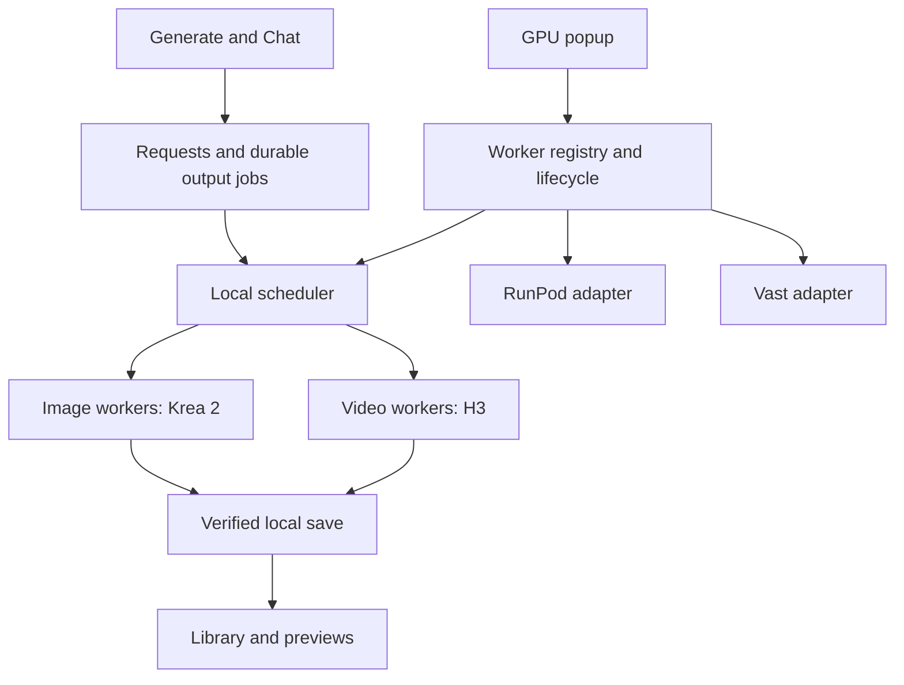

**Worker pool buildout plan — September 22, 2026**

This is the implementation plan requested by the owner. It supersedes the
runtime direction and UI proposal in `provider-restoration-plan.md`. This turn
changes documentation only. Implementation and visual QA will use simulated
providers and workers; no real GPU, CPU pod, volume or other rental is to be
created. Performance tuning and paid inference validation are deferred.

Revised after a comparison of main and the current branch by three independent
reviewers plus the primary agent. The owner clarified that secrets belong in
Admin and costs belong to worker rentals. Per-generation pricing and price
approval gates are removed from the proposed product. Implementation awaits
alignment on this revised plan.
The owner also limited LoRA provisioning to new workers: imports affect the next
compatible launch, with no live adapter installation or worker migration.
LoRA binaries download directly from Civitai to those workers. The local app
stores catalog/source metadata; it is not a required relay for adapter files.
Worker controls include both Finish jobs and quit and Cancel jobs and quit now.
Closing the UI leaves the background server and its jobs running. Visual QA must
deliver numbered, captioned desktop/mobile mosaics and full-size screenshots.
The final product choices are settled: workers stay rented until explicitly quit;
new workers prepare all enabled compatible LoRAs; a failed LoRA download offers
Retry preparation or Continue without that LoRA before the worker becomes ready.

**Decisions and scope**

- Work on `codex/fal-only`; preserve the current application and selectively port
  the proven worker/provider code from main. Do not switch to main or merge its
  old application wholesale.
- The application is self-service end to end. Once the user saves credentials
  and selects a priced launch, the app owns allocation, connection, preparation,
  scheduling, output recovery and release. No agent, terminal command, manual
  pairing-code exchange or separate operator workflow is required.
- Two logical worker classes and two deployable Linux/amd64 images: Image and
  Video. Both work on Vast and RunPod. Each rental owns one GPU and one active
  generation slot; separate machines can run concurrently.
- Restore the old ComfyUI runtime and known recipes. Krea 2 is the active image
  model. H3 keeps the pruned INT8 ConvRot DiT, INT8 conditioner, native VAEs,
  existing 30-step HQ sampler and Kitchen/Sol attention settings. No SGLang port,
  precision experiment or reintroduction of the old Fast product mode.
- Include Qwen Image 2.1's editing dependencies and pinned model assets in the
  image container. The official model is unified generation/editing, rather than
  a separate assumed `Qwen-Edit-2.1` repository. Do not expose editing workflows,
  agent tools or controls yet, or load Qwen into VRAM during Krea startup.
- Keep the current Generate, Chat request approvals, LoRA import/mapping,
  visibility rules, Library, previews, Pick Frame, completion toasts and Activity.
- Show active workers' aggregate hourly rate and estimated spend, with per-worker
  detail in the GPU popup. Remove generation cost previews and estimate-dependent
  submission/approval logic. Rental acquisition retains its explicit rate quote.
- Restore a compact sidebar GPU status control opening a worker-management
  popup. Acquisition is explicit through that popup; submitting a generation
  never silently buys more workers.
- Remove fal as the executor for new requests. Preserve existing media/history
  and handle any in-flight fal work explicitly during migration.
- Freeze the installed LoRA set when a worker is launched. New imports and file
  mapping changes take effect on later workers. Existing workers continue with
  their prepared set; selecting among installed adapters remains per request.
- Keep workers running until the user explicitly requests one of the two quit
  actions. There is no idle timeout, empty-queue shutdown or automatic release.
- Download LoRA files on the worker directly from pinned Civitai sources during
  boot preparation, using the Admin-managed token when required.
- Keep scheduling, preparation, cost accounting, cancellation and rental release
  in the background server. Closing any browser/app window does not stop them.

**Architecture**

The existing Fastify server and SQLite remain the coordinator. Provider
adapters allocate and inspect resources; worker transports run jobs; neither
belongs in React or in the Chat model's tools. Image and Video are worker
classes, not provider choices or separate user-facing H3 variants.

React renders server state and submits explicit commands; it never owns job
dispatch, polling needed for execution, rental timers, retries or release policy.
UI hooks own only view state, queries/subscriptions and mutations. Durable server
operations survive disconnected browsers and resume visibility when one returns.
The local background server starts independently of the UI and remains running
after its window closes. Retain the existing detached-server launch pattern.

Use one coordinator per user data root, fenced before any scheduler or provider
reconciliation starts. A second server on a different port must not run another
lifecycle loop against the same database. Multiple browser tabs and LAN clients
share that coordinator and receive the same operation identities and state.

**Reuse boundary: restore the worker, not the former application architecture**

| Existing implementation on main | Treatment in the consolidated app |
| --- | --- |
| Worker API, authentication, preparation protocol, resumable transfers, verified model acquisition, output spool, receipts and telemetry | Reuse the underlying implementation and tests; parameterize role-specific assets and capabilities |
| Krea/H3 graphs and pinned inference dependencies | Preserve the working recipes; split model preparation by Image/Video role |
| Vast/RunPod clients, offer validation, SSH setup, connection, readiness checks and deletion verification | Port reusable functions into typed server services with injected transports, cancellation and progress events |
| CLI orchestration, repository-relative runtime imports, console progress and manual resume instructions | Replace with app-owned lifecycle operations, packaged resources, persisted state and UI actions |
| Singleton rental files, fixed local tunnel ports, account-wide one-pod guards and global queue pause | Replace with per-worker ownership, transactional assignments and scoped drain/recovery |
| Old application screens, settings architecture and agent-operated setup workflow | Do not restore; extend current Admin, Activity, shared UI and hooks |

Main already contains much of the difficult preparation and recovery behavior.
The work is to retain those algorithms while changing their ownership and state
boundaries. Do not build the new app by shelling out to the old lifecycle CLI.
Managed SSH subprocesses remain an implementation detail owned by the server,
with per-worker ports, credentials and process cleanup.

The complete user journey is: enter provider credentials in Admin, open the GPU
popup, select offers and approve their displayed rates, then watch workers become
ready. The server automatically creates the rental, establishes SSH, authenticates
the worker, installs the frozen role/model/LoRA manifest, acquires/verifies assets
and confirms readiness. LoRAs download directly from Civitai to the worker;
existing optional local-cache fallback is confined to base-model preparation.
Generate and Chat use the same scheduler; completed
assets are saved locally before release. Failures expose a useful explanation
and a scoped Retry/Reconnect/Release action rather than instructions to ask an
agent or run a command. Preparation and recovery also appear in Activity, without
restoring the former global pause/queue-management UI.

**1. Worker images and model storage**

| Image | Active runtime | Included model support | Startup behavior |
| --- | --- | --- | --- |
| `seed-worker-image` | Pinned existing ComfyUI + Krea graph | Krea 2; separately pinned Qwen Image 2.1 editing runtime and assets | Prepare/load Krea only; Qwen remains on disk |
| `seed-worker-video` | Pinned existing ComfyUI + H3 graphs | FL2VA and Ref2VA, shared encoder and VAEs, selected custom LoRAs | Prepare both H3 partitions; load the needed variant; report model switching |

Use common source for the worker API, SSH startup, identity, model verification,
transfers, receipts, cancellation, output spool and telemetry. Share build layers
where dependency versions allow it, but produce independent release digests and
model manifests. No duplication of two application backends.

Keep Qwen's Diffusers/Transformers environment isolated from the old Krea Comfy
environment so adding a new model does not silently upgrade the proven runtime.
Pin package versions, source revisions and model hashes. Image build validation
must check actual Qwen assets/configs and an offline pipeline import, not just a
directory or placeholder file. Ship its weights in a separate immutable image
layer as requested; account for the larger image pull in storage requirements
and preparation estimates. Qwen being packaged is not a claim of GPU inference
qualification.

Keep Krea/H3 weights in role-specific, checksum-verified worker storage using the
existing resumable acquisition path. Stage on local disk where the host provides
it; do not assume every provider mount is local NVMe. Do not fetch image models
onto a Video worker or H3 onto an Image worker. Custom LoRAs remain outside the
images. Retained storage must be an explicit policy, not an orphaned default.

The H3 worker supports both graph variants through the existing loader. Do not
promise both DiTs stay resident or that switching is free. One process/slot per
GPU avoids image jobs evicting H3. Warm-variant affinity is a scheduler preference,
not a reason to starve older queued work.

Keep workspace identity, worker-instance identity and engine-session identity
distinct, alongside role, protocol version, graph/runtime revision and image
digest. An engine restart invalidates session-bound dispatch while retaining
durable output receipts. Workers incompatible with an app update remain visible
for recovery/release but receive no new jobs.

The initial Video hardware profile is RTX PRO 6000 Blackwell 96GB. Image has its
own hardware requirements and need not require 96GB; preserve the known 96GB
baseline while treating cheaper 32GB candidates as pending live qualification.
Qwen's future editing memory envelope is not assumed from Krea's requirement.

**Current request-to-worker compatibility**

Preserve current public request fields and translate them into the restored
runtime internally. Images keep the current 1280 x 720 / portrait dimensions;
video keeps native 1344 x 768 / portrait, 24 fps, 5–15 second lengths and the
Generated/Silent soundtrack control. Do not restore Fast, frame-sequence export,
user-facing capability revisions or automatic mode-selected LoRAs.

Main's graph and worker validator support one global preset and hardcode H3 HQ
adapter strength to 0.8. Replace both with the current explicit ordered selection
of up to three LoRAs and their chosen strengths. Preserve the base model, sampler
and attention recipe while validating the complete adapter chain and immutable
files on the worker. A hidden mode filters the available catalog; it does not
silently load a preset or change a selected strength.

Restore the old runtime's valid reference-video frame lattice and audio alignment
inside a versioned preparation recipe. Current fal preparation uses a different
frame count; bump prepared-media cache keys so its files are not reused silently.
Keep current media metadata, local Pick Frame and preview behavior. Restore
mixed general references plus first/last image guides where the existing graph
supports them; update validation, controls and Chat guidance together. Preserve
input order, stable instance IDs, ranges, framing and prompt-mention mappings.

**2. Provider discovery and acquisition**

Reuse main's Vast and RunPod lifecycle code, including the existing RunPod REST
v2 adapter. Replace singleton rental files, one-worker acquisition guards and
fixed tunnel ports with per-worker records. Do not merely remove those guards:
concurrent create reconciliation and ownership must change with them.

Normalize offers into a shared record: provider, offer/GPU/region identifiers,
worker class, GPU count, VRAM, reported power limit, CPU/RAM/disk, hourly compute
and disk charges, transfer charges when available, availability confidence,
quote timestamp and expiry. Provider-specific facts remain optional; an unknown
Vast-style reliability score on RunPod must not become a made-up rating.

Query providers independently with bounded timeouts. Show partial results when
one fails, cached results marked stale, and provider-specific credential or
capacity errors. A catalog availability indication is not a reservation.

Preflight the selected role before allocation: compatible GPU/runtime, enough
host disk for the image and unpacking, models, staging and outputs; sufficient
local output/cache space; required source access; and available transport tools.
Derive requirements from the actual role/image manifests instead of restoring
main's fixed disk sizes. Qwen's baked weights count toward Image pull/unpacking.
Reuse and deduplicate local model-cache downloads across preparing workers, with
bounded transfer concurrency. Avoid turning a pool launch into four redundant
downloads on the PC or a transfer queue that blocks interactive app requests.

Create a batch launch intent plus durable per-worker acquisition attempts before
sending requests. Assign each an app-owned correlation ID where the provider
supports it. Reserve aggregate approved hourly cost atomically, then acquire with
bounded concurrency. Recheck expired quotes and material price changes before
purchase. Do not substitute a different GPU/class or exceed the approved rate.

After an ambiguous create response, reconcile that attempt before retrying. If
the provider cannot distinguish concurrent creates reliably, serialize that
provider's uncertain operations rather than risk duplicate rentals. A partially
successful launch keeps its successful workers and offers retry for failures.

Each worker gets its own provider ID, SSH host identity, local tunnel port,
process ownership, authentication material and remote worker identity. Verify
the reported GPU, protocol and image/model profile before scheduling. An unknown
account resource is never automatically adopted or deleted.

**3. GPU popup and interaction design**

Place a compact GPU status entry in the sidebar's lower area, with Admin still
at the bottom. Show no active workers, preparing count, ready/busy count, or a
needs-attention indicator; show the aggregate hourly rate when workers exist.
Also show `Estimated spent` for those active rentals. Reading this summary uses
local state and must not wait on provider APIs. Closing the popup or changing
application page does not stop monitoring or reset the displayed spend.

Clicking opens the shared accessible modal, with two views:

- **Workers:** each row shows Image/Video, GPU, provider, state, current work and
  hourly rate, rental elapsed time and estimated spend since allocation. Expand
  for preparation stages or a useful failure message.
  Actions include reconnect/retry, **Finish jobs and quit**, and **Cancel jobs
  and quit now**. The immediate action is always available, including while
  preparing, generating, saving or disconnected. Show equivalent controls for
  the whole pool with the affected workers and aggregate hourly rate made clear.
- **Add workers:** choose Image or Video, browse one combined provider list,
  filter by provider/region/maximum hourly rate, and select capacity. Use quantity
  only where an offer supports it; a Vast single-instance offer is not an
  unlimited stock item. Multiple selected offers can form one launch batch.

Offer rows prioritize GPU, VRAM, provider, region and price. RAM, disk, power and
transfer costs are expandable decision details. The footer shows selected worker
count, added hourly rate, new total pool rate and known one-time preparation
charges/uncertainties. The primary action reads, for example, `Start 3 workers`
and is visually distinct when ready. Its click submits the quoted launch intent;
there is no redundant confirmation screen for the same priced choice.

Keep form fields full width, use existing shared buttons, field rows, cost
footers, empty states and modal primitives. Desktop uses compact list rows;
mobile uses stacked rows and a full-height dialog with a reachable sticky action
footer. Handle focus restoration, Escape, keyboard selection, loading, retry and
disabled states. No secret values or internal pipeline names in the popup.

Add Vast and RunPod keys to Admin Credentials using the current per-user secret
store; retain OpenRouter and Civitai, plus an optional Hugging Face token if an
asset requires it. The app must launch with no credentials and let the user set
them in Admin; remove the CLI setup requirement for a fal key and keep start
keyless. Library and
drafting continue to work when a generation provider is unconfigured.

All provider clients, preparation/cache services and Chat read one server-side
credential resolver with the current saved-value precedence and explicit Remove
semantics. Adapt main's environment-first helpers to it. Migrate legacy names
such as `civitaiApiToken` to `civitaiKey` once, without overwriting a canonical
saved value or resurrecting an explicitly removed key. Preserve per-user private
storage and return only configuration/validation status to the browser.

Saving or rotating a key takes effect without restarting the app. Invalidate
only that provider's catalog/auth state, keep unrelated jobs running and provide
provider-specific missing/invalid/balance/permission errors with an Admin action.
Bind rentals to their provider account identity; a replacement key for another
account must not reassign or hide existing rentals. Validate a replacement can
manage outstanding owned resources before replacing a usable key. Block removing
a key needed for an outstanding rental, explaining which workers must first be
released. External revocation instead exposes Update credentials while retaining
ownership, receipts and estimated spend. Read-only Test connection creates no
resources. Worker pairing/SSH secrets are generated by the app and require no
additional Admin fields. Cloud provider and OpenRouter keys stay on the PC;
only required model-download tokens
are sent through the authenticated preparation channel, never logged.

Use domain hooks such as `useWorkerPool`, `useWorkerOffers` and `useWorkerLaunch`.
Keep server state separate from popup filters/selections; use typed reducers for
launch state and avoid adding provider-specific state to `app.tsx`.
One app-scoped store/query lifecycle owns pool updates, with a shared spend
formatter/clock and a consistent worker-state presentation. Existing Modal,
buttons, fields, status badges, Activity rows and toast/preview behavior remain
the primitives. New `WorkerSummary`, `WorkerRow` and `WorkerOfferRow` compose those
primitives. Route changes must not create duplicate polling loops; abort stale
offer searches and discard late responses after filters or credentials change.
Extract the current Admin credential form into a typed `CredentialCard` and
`useCredentials`; Admin and acquisition consume the same safe status. Pending
actions are per worker/provider, so releasing one does not disable the whole pool.

Replace the single fal-configured flag with service credential status, pool
summary by Image/Video class, queue/readiness state and actionable preflight
issues. Missing RunPod access does not disable Vast; missing OpenRouter does not
disable Generate; missing Civitai only blocks catalog/source operations that
require authentication, including required worker downloads identified preflight.

The pool and its spend always include every owned rental, independently of the
hidden content mode. A worker running content outside the current view shows a
generic activity label, without its prompt, thumbnail or LoRA names. Mode changes
never hide a billable worker, reset spend, or rent/release capacity. Preserve the
existing generation/import visibility rules and discard stale mode-bound results.

Use one shared Activity item contract for generations, LoRA imports and worker
lifecycle operations, with stable IDs and links back to the correct job or worker.
Preparation, including boot LoRA installation, is a stage of the worker operation.
Count one actionable failed worker once, rather than once for every queued
job waiting on it. Reuse the existing Activity page and avoid a second operations
dashboard or global pause controls.

**4. Scheduling, recovery and release**

Keep one parent request and one durable job per requested output, with immutable
seeds, settings, references and LoRA revisions. Quantity four can occupy four
Video workers, or run sequentially on one. Return each output immediately. No
cross-worker tensor sharing, multi-GPU inference or true tensor batching in v1.

Match jobs by worker class and runtime compatibility, prefer already loaded
variants, require the selected installed LoRA revisions/mappings, and preserve
fair ordering. Snapshot execution-profile versions per job so a future tuning
change cannot alter an already queued job.
Cancel only the assigned job; a worker failure must not block unrelated workers.

No workers means `Waiting for an image/video worker`, with an action opening the
appropriate Add workers view. Allow valid requests to be submitted/approved into
that queue without a price estimate or a ready worker. Opening the popup or Admin
must preserve prompts, references, LoRA choices and approval/review context.
Chat can propose and submit normal generation requests but cannot rent compute.

Remove `useEstimate`, generation cost footers and `X-Seed-Estimate` requirements
from Generate, Repeat, Chat approval cards and expanded Review. Remove matching
server pricing acceptance and fal-configuration gates in every submission path.
Delete the unused generation estimate route/service and update their tests.
Keep request revision checks, validation, reference readiness, user approval,
resolved seeds and idempotency. Runtime/worker changes do not invalidate an
otherwise unchanged creative request. No generation approval triggers a rental.

Use one typed recovery contract across Generate, Chat, Activity and the GPU popup:
issue source/scope, affected worker/job, retryability and allowed actions. Replace
fal billing/history links and manual verification wording with Open worker,
Reconnect, Retry transfer/save, Cancel or Retry failed outputs as appropriate.
Preserve completed siblings of a partially failed quantity request, same/new-seed
choices and branching into Chat/Generate. Retrying uncertain execution is distinct
from repeating a definitively failed output. Unknown job state remains visible
until resolved and is not silently rendered as an ordinary failed/retryable job.

Use forward SQLite migrations for workers, acquisitions, job attempts, worker
events and cost ledgers. Enforce one active assignment per worker and one active
attempt per output transactionally. Persist dispatch identity before sending;
worker-side idempotency and receipts reconcile lost responses and restarts.
Expired heartbeats do not mean a job failed or billing stopped. Never blindly
resubmit an execution whose outcome is unknown.

Public states stay understandable: Starting, Preparing, Ready, Generating,
Saving, Reconnecting, Finishing, Releasing, Released, Needs attention. Internally
keep resource state, connection health and execution state separate.

Workers stay running until the user explicitly quits them. Empty queues, idle
time, completed generations, closed UI windows and failed preparation never
trigger automatic release. Remove the proposed initial idle grace period and
automatic finish-queue policy; no Keep running toggle is needed. Show hourly
rate and accrued estimated spend while the rental remains alive. Both quit
actions remain available regardless of worker health:

- **Finish jobs and quit:** finish already accepted compatible work, recover and
  verify outputs, acknowledge the spool, then terminate the rental. Record a
  cutoff so later requests cannot keep extending the worker's lifetime. Atomic
  assignments may draw only from that pre-cutoff backlog while finishing. Other
  workers can continue serving new requests. A job needing an uninstalled LoRA
  does not keep an incompatible worker alive indefinitely.
- **Cancel jobs and quit now:** stop admitting work, persist cancellations and
  terminate the exact rental without waiting for inference, SSH, successful
  cancellation acknowledgement or a blocked output download. A brief notice
  identifies running/unsaved work that may be lost; the explicit action allows
  proceeding. Already saved local outputs remain. Mark affected attempts without
  automatically replaying them elsewhere. Cancelling the whole pool also cancels
  its queued work; quitting one worker affects its assigned/reserved work while
  unrelated queued work can continue on other workers.

Quit-now also cancels pending launch intentions. Reconcile an in-flight create
whose response arrives late and immediately terminate any rental it produced;
do not leave that resource untracked or start preparation after cancellation.

Quit means provider termination/destruction of the owned rental and its disposable
disk, not pausing a container that can retain billed storage. Do not create
persistent volumes in this phase. If any retained resource exists from a prior
configuration, show it separately rather than implying all spend is stopped.

The server submits and reconciles termination independently of the UI. A failed
provider call or lost reply must show `Termination unconfirmed — may still be
billed`, with retry and the relevant provider-console link. Never require access
to the worker before attempting provider termination. Successful provider
confirmation ends that rental's meter; a click or an SSH disconnect does not.
Normal finish-and-quit protects unsaved outputs; quit-now is always the escape
route when preserving them would keep a broken worker rented.

Closing the UI does not invoke server shutdown, cancellation or worker quit.
Jobs, model preparation, output saving, spend tracking and the selected release
policy keep running in the background with zero open browser clients. On an
explicit backend stop/update or process exit, persist operations and stop only
owned local transports before closing the database. On restart reconcile rentals,
identities and receipts before fresh dispatch or release. Upgrades retain records.

The server host must remain awake: powering off/sleeping that PC interrupts its
coordination even though an already executing remote job may continue. Recovery
resumes when the server returns. A hosted coordinator or autonomous remote release
mechanism is outside this build; closing a UI window is supported independently.

**5. LoRAs, costs and migration**

Preserve the grouped Civitai catalog flow: family detection, explicit per-file
workflow mappings, names/descriptions/strengths and existing visibility behavior.
URL lookup and Apply run on the server. Apply stores the selected model/version/
file IDs, pinned source URL, expected SHA-256, size, mappings and user guidance;
it does not download the full adapter to the PC or upload it to fal. Report catalog
registration through the confirmation toast and Activity. Metadata validation is
not a claim that model tensors have been downloaded or tested.

At launch approval freeze all enabled, role-compatible source records and the
runtime profile. There is no separate LoRA picker during worker launch. Include
both catalog visibility categories for the role, while keeping the existing
selection/content visibility rules in the application. Deduplicate identical
file hashes in downloads without losing their workflow mappings. Every worker
in that launch batch, including acquisition retries, uses
that snapshot; catalog additions made mid-launch do not change it. The worker
downloads the actual files directly from Civitai/CDN using main's resumable source
downloader, verifies expected size/hash and validates the adapter format during
boot preparation. The server supplies the Admin-managed Civitai token only over
the authenticated preparation channel. Never forward it to CDN redirects or
persist it in a manifest/log. Fresh expiring download redirects are resolved from
the pinned source; filenames are not the identity or workflow mapping.

Use the original Comfy-compatible adapter file. Remove mandatory fal-format
conversion from new catalog registration; do not assume previous converted
artifacts suit the worker. Unsupported files, lost source access or failed hashes
produce actionable preparation errors, never an automatic version substitution.
Retry the direct download against the same pinned source. No new local adapter
cache, PC-upload fallback or general conversion service is part of this scope.

If an adapter fails but required base assets are ready, show its name and failure
with **Retry preparation** and **Continue without that LoRA**. Keep the worker
rented and make its current rate/spend and both quit actions visible while it
awaits the user's choice. Retry resumes only unfinished files against the pinned
source, retaining verified downloads. Continue records an explicit omission for
that worker, finalizes its successfully verified adapter set and allows readiness.
Required model/runtime failures cannot be skipped through this action.

Preserve the original launch manifest and persist omission decisions separately;
do not silently rewrite the intended files or treat an omitted adapter as
installed. Drain/cancel its unfinished download before finalizing readiness.
Scheduling uses the worker's actual verified set, so a request for the missing
adapter waits for another compatible worker instead of running without it. Once
ready, no background retry installs the omitted file; it can be attempted on a
later worker. Both choices and their state survive browser closure/server restart.

Do not restore a single globally mutable LoRA preset; selections belong to jobs.
Test switching among installed adapters without leaking adapter state into the
next job. Qwen LoRA import support is out of scope for this phase.

Existing workers retain their prepared files and mappings until released. Newly
imported/updated LoRAs are available on later workers; do not upload them live,
mutate readiness manifests, restart workers, or automatically acquire replacements.
If a queued request requires an adapter no compatible worker has, show `Waiting
for a worker with this LoRA` and Open Workers, retaining its exact selection.
Provide a compact `Needs a new worker` availability hint when selecting that
adapter. Requests needing already installed adapters continue to run.

Descriptions, names and default strengths can update in the app without moving
model files; submitted jobs retain their own snapshots and chosen strengths.
Current visibility/enabled rules still govern new requests. They do not erase
installed files or silently substitute another adapter in an approved request.
Retain pinned source records needed by launch manifests and queued jobs even if
their catalog entry is subsequently replaced or archived. Existing fal-era local
original/converted files remain preserved for history; they are not the normal
distribution path and this migration does not delete them.

Reset fal-specific verification to an appropriate runtime-specific status.
Replace old `uploaded` flags/copy and binary-import progress states: catalog
registration is local metadata, while direct boot download belongs to the worker's
Activity. No live adapter-sync endpoint, eviction manager or migration machinery.
Normal reference uploads for each job and verified output downloads remain.

Costs belong to rentals, not outputs. Persist each worker's accepted quote,
provider/account/resource identity, allocation/billing timestamps, rate components
and confirmation status. Integrate hourly compute and disk rates over the rental
lifetime, including billed preparation, generation, idle, reconnecting and release
periods. Use provider billing timestamps when known and an explicitly estimated
allocation timestamp otherwise. Do not start the meter at worker readiness or
stop it at an SSH failure, cancellation click or app restart.

The sidebar shows active rentals' combined hourly rate and estimated spend since
their respective allocations. The popup breaks these down per worker. Persist
completed rental totals in existing Activity so the spending record
does not vanish when active totals fall after a release. Paused/offline status
does not imply zero cost; retained storage or unresolved deletion remains visible.
Make every billable or possibly billable resource easy to identify, including
starting, preparing, idle, disconnected and terminating workers. Show compute,
disk and known transfer components in its details. A failed job does not hide
the rental or its quit actions. Rates/spend describe app-owned workers, not the
entire provider account or OpenRouter usage.

Use the accepted resource rate, not a later marketplace offer, and avoid adding
disk twice when a provider quote already includes it. Add known transfer charges
only from attributable bytes/rates; disclose unmetered extras instead of inventing
totals. Unknown rates must not silently sum as zero. Keep amount calculations
consistent and rate intervals durable across restart. The browser may animate
elapsed time from a server snapshot but never owns the spending record. Provider
invoice reconciliation is deferred; existing billing readers are a future reuse
point, not a new subsystem required for this build.
No separate billing key, account-wide balance treated as worker spend, per-output
allocation of startup cost, or generation timing price model is required.

Introduce shared request/job/worker/cost/error types independent of `server/jobs.ts`
and fal. Back up the database before migration and preserve Library/chats/LoRAs.
Completed fal history stays readable. Any in-flight fal jobs must be recovered
through the existing executor before cutover or explicitly parked for review;
never replay them on a rented GPU. Remove new fal submissions and active fal
configuration from the normal UI once migration completes. Keep only the legacy
receipt compatibility needed for retained data; do not keep two full executors
as permanent product complexity.

Migrate browser draft storage (`seed.drafts.fal.v2`) without clearing prompts,
seeds or reference selections. Preserve historical LoRA names, versions, hashes
and strengths in request snapshots; catalog edits must not reduce their display
to an unnamed adapter. Retain asset notes, same/new-seed branching, output deletion
guards and Pick Frame provenance. Keep only short database/asset mutations
serialized; long preparation/transfers must not block unrelated workers or UI.

Package every required manifest, release definition and helper so the installed
application works outside this checkout. Replace repository-relative imports and
assumptions that users installed an `hf` CLI; provide app-owned acquisition and
transport prerequisites, checking them before rental. Preserve LAN access and
the current origin/host checks without exposing private worker-control ports.

**6. Offline testing and visual QA harness**

Extend the existing Playwright/local-server setup into a dedicated worker-pool
harness that exercises the real Fastify routes, scheduler, SQLite migrations,
transfers and React UI through injected provider/worker boundaries. UI-only mocks
are insufficient for acquisition and recovery coverage.

- Launch under a fresh test data/config root on its own port. Never read the
  user's credentials or modify the installed app, Library or active profile.
- Fake Vast/RunPod HTTP transports provide realistic catalogs, quotes, receipts,
  allocation transitions and errors. Fake workers implement identity, health,
  asset upload, job submission, cancellation, receipts and output acknowledgement.
- Use decodable local image/video/audio fixtures with checked hashes. These
  validate media plumbing, not model quality. No inference provider calls.
- Fail closed on unhandled network requests. Test mode cannot construct live
  rental adapters or fall back to live transport. Block external network access
  in both the backend harness and Playwright; use a stripped environment and
  restrict subprocesses to owned local test helpers. Assert zero external calls.
- Expose a development-only scenario controller with deterministic time/state
  advancement. It must be absent from production routes and packaging.
- Provide one command to run automated checks and one to open the same fixture
  app for manual Chrome/computer-use inspection, with screenshot/trace artifacts.

Cover the happy path from popup selection to simulated workers, Generate and Chat
approval, Quantity distribution, individual completion, preview/Library save and
confirmed release. Include zero workers, mixed 1/2/4-worker pools, missing keys,
one provider offline, stale offers, price changes, insufficient balance, capacity
lost at launch, partial batch success, ambiguous create/submit/delete responses,
slow preparation, interrupted upload/save, model switching, cancellation, worker
loss, local server restart, retained unsaved output, and archived fal history.

Add these integration acceptance cases from the branch comparison:

- Fresh keyless install; Admin Save/Test/Remove; legacy token migration; one
  provider unavailable while the other works; same-account rotation and externally
  revoked keys while a rental exists. No secret in public state/logs/screenshots.
- Generate, Repeat, Chat approval and expanded Review submit without estimate
  requests/headers. Zero capacity queues work and opens the correct worker class;
  Admin/popup round trips preserve drafts, uploaded inputs and approval context.
- Import a LoRA during worker preparation: the current manifest is unchanged,
  the next launch includes it, old workers continue compatible jobs, and requests
  requiring the new revision wait without uploading it live or auto-renting.
- Catalog Apply uses metadata calls only; the fake worker exercises direct pinned
  Civitai downloads during boot, resumed transfer, expiring CDN redirects, missing
  access and hash failures. No PC binary download/upload or leaked source token.
- Every launch includes all enabled adapters compatible with its class without
  a picker. One failed adapter offers Retry preparation or explicit Continue
  without it; successes are retained, base-model failures cannot be skipped, and
  readiness advertises only verified files. Requests for an omitted adapter wait
  for compatible capacity. No late/background download mutates a ready worker.
- Adapter selection/strength reaches both the graph and worker validation; old
  stored conversions retain historical provenance. Reference preparation covers clips,
  soundtracks, fit/fill, duplicate sources, mixed guides and label remapping.
- Partial Quantity completion followed by failed-only retry; branching to Chat
  and Generate; local save/Pick Frame/deletion races; scoped recovery actions.
- Spend across preparation, idle, reconnect and uncertain deletion survives app
  restart and mode changes. Unknown charges stay labeled; released records remain
  in Activity; no hidden-mode content leaks through global worker rows.
- Two coordinator processes cannot own one profile. Independent tunnels survive
  the other worker's cancellation. Shutdown/restart and installed-app upgrades
  preserve rental ownership, boot manifests and spool recovery.
- Close every browser during preparation, generation and saving; server work and
  release policy continue. Reopening shows the current state and retained spend.
  Advance the clock with an idle or empty-queue worker and verify no automatic
  termination, including after a request completes or preparation fails.
  Finish-and-quit drains the pre-cutoff queue; later work cannot extend it. Quit
  now works during download, generation, save, lost SSH and unknown execution,
  attempts provider termination without a worker response and preserves saved
  local files. Test pool-wide cancellation, quit during an uncertain create with
  a late success, and failed/unconfirmed termination.

Port main's local SSH, preparation recovery, process ownership and spool tests
beneath the fake-provider harness. These exercise the actual transport/process
boundaries without rentals; remove any remote-config path from the default test
entry point. Run package acceptance from an installed tarball outside the repo,
using the same simulated lifecycle and no developer environment credentials.

Visual QA includes desktop, tablet and narrow mobile, empty/loading/error/busy
states, long GPU names, many offers, keyboard focus, scrolling and sticky-footer
overlap. Capture and inspect screenshots; do not claim visual QA from assertions
alone. Recheck Generate, Chat approvals, Admin and Library for regressions.

**Numbered visual review atlas**

Deliver reviewable mosaics, not just a folder of screenshots. A checked-in scenario
catalog assigns stable numeric IDs to distinct user-visible states, with a short
title, setup/actions and the expected result. Keep the same ID across devices and
reruns so feedback such as `023 mobile` identifies one scenario unambiguously.

| Surface | Required scenario coverage |
| --- | --- |
| Generate: all three workflows | Empty/invalid/ready, reference controls, LoRA selection and needs-new-worker, zero capacity, queued/running/saving/complete, failure and partial Quantity completion |
| Chat | Compose, request approval, expanded review/edit, queued and running requests, partial results, retry/branch, missing credentials and recovery actions |
| GPU popup | Empty pool, unconfigured provider, offers loading/empty/partial/error, filtering/selection/quote changes, partial launch, preparing/ready/busy/idle/disconnected, failed LoRA Retry/Continue choices, rates/spend, both quit actions and failed termination |
| Admin | Credential Save/Test/Remove/rotation/error, Civitai lookup and unsupported family, file mapping, catalog confirmation, existing/new LoRA worker availability |
| Activity | Mixed operation types, stage progress, actionable failure, completed rental costs, navigation into the affected worker/job |
| Library and previews | Empty/mixed library, image/video preview, Pick Frame, reference reuse, notes, deletion guards and branch actions |
| Cross-page interactions | Admin round trip preserves draft, popup focus restoration, sidebar/mobile navigation, content visibility transitions, late async responses, no browser attached and subsequent return |

Enumerate all distinct states on these surfaces and all critical journey branches.
Use pairwise coverage for secondary combinations such as provider, worker count
and long text rather than multiplying every option against every other option.
Record intentional exclusions; do not claim exhaustive coverage of all possible
application states. Tablet checks target overflow/focus, while every atlas scenario
gets desktop and mobile captures (initially 1440 x 1000 and 390 x 844).

Each tile contains **the test number + short scenario title + its screenshot**.
Create separate desktop and mobile contact-sheet PNGs, paginated into readable
groups rather than one enormous illegible image. Preserve screenshot proportions;
never crop out the action/error being reviewed or use fake placeholder screens.
Retain full-resolution screenshots and extra full-page images for long screens.

Also generate a static HTML index with filters for surface/device/status and links
from each numbered tile to its full screenshot, plus a JSON manifest linking ID,
title, viewport, scenario, assertion result and artifact paths. Titles and IDs
must match the automated test output. Include the app revision in the report.
Failed scenarios remain listed as failures; do not silently omit missing captures.
Use deterministic fixture data/clock and wait on actual UI state before capturing.

Reuse main's Sharp-based mosaic generator as a starting point, fixing its missing
capture handling and adding captions, pagination and the HTML index. The reports
come from the real fixture app, not separately authored UI mockups. Provide one
command for tests plus the atlas and a way to serve the static reports on the
configured local network for review from another device, without production data
or credentials. Inspect the mosaics and full-size images before delivery.

Also run Python worker tests and CPU container checks for startup, health/API
schemas, role isolation, installed dependencies, model manifests and Qwen's
packaged assets. Build both images locally or in an explicitly configured build
environment; build/export digests and a release manifest. No rental or deployment
is part of these checks. If the build environment cannot validate an image, mark
that deliverable incomplete rather than call Dockerfile review a passing build.

**7. Implementation sequence and acceptance**

1. Extract neutral contracts, add schema migration and dependency injection, and
   establish the offline provider/worker harness before any live adapter wiring.
2. Restore common worker/transport code, split Image and Video build targets,
   preserve graph recipes, package Qwen separately inside Image, and add role
   readiness/asset manifests.
3. Restore provider adapters behind durable per-worker acquisition/reconciliation;
   add the catalog aggregator, worker registry, per-worker tunnels and scheduler.
   Move lifecycle orchestration into the app, including automatic authentication,
   direct-source preparation, optional base-model fallback and resumable recovery;
   no CLI wrapper and no LoRA binary relay through the PC.
4. Connect current Generate/Chat jobs and LoRAs; remove generation-price gates and
   implement rental spend accounting, output-save, cancellation, restart and
   release behavior. Verify one image and one video job
   execute concurrently in the harness and four variants distribute correctly.
5. Build the sidebar status and GPU popup, credentials additions and Activity
   integration using shared components/hooks. Iterate through automated and
   manual visual QA on the same isolated scenario app.
6. Finish image builds, migration/package checks, targeted fault tests and the
   normal verification suite. Deliver the reviewed UI, runnable offline harness,
   build artifacts/manifests, numbered desktop/mobile mosaics with full-size
   screenshots and a review index, operating notes and known limits.

Acceptance requires the complete simulated acquisition-to-output-to-release
journey from both Generate and Chat, no duplicate rental/job on retries, no
cross-worker blocking, preserved data/UI behavior and no external provisioning.
That journey must be achievable entirely through the application, including
recoverable failure cases, with no agent intervention or terminal commands.
It must continue with no open browser clients. Both quit actions must be reachable
for every owned worker and the pool, with truthful termination/cost status. The
visual atlas and its numbered coverage index are required delivery artifacts.
Idle workers remain rented until an explicit quit instruction. All compatible
enabled LoRAs are included at launch, with explicit retry/omission handling for
failed adapters and no live installation after readiness.
No claim of current GPU throughput, CUDA execution, Qwen editing quality or real
provider placement is possible without a later authorized live validation.
Performance tuning, Qwen editing UI/workflows and any serverless/SGLang migration
remain subsequent work.

Keep scope contained: no live LoRA installation, automatic worker replacement or
autoscaling, multi-GPU execution, new image-editing UI, provider billing dashboard,
remote control-plane service or performance/precision experiment in this phase.
The added lifecycle contracts support the two worker classes and the current
application's existing workflows.

**Evidence used**

- Current `codex/fal-only` source: `server/jobs.ts`, `server/http.ts`, schema 7 in
  `server/db.ts`, current React hooks/shared UI, Playwright fixture server and
  offline transports in `scripts/offline-providers.mjs`.
- Preserved main: provider REST v2/lifecycle modules, worker Dockerfile/model
  manifest, SSH startup, graph builders, spool/receipts and recovery tests.
- Cohesion review: price gates in `web/generate.tsx`, `web/request-card.tsx`,
  `web/review-request.tsx`, `server/http.ts` and `server/chat/service.ts`;
  `server/credential-store.ts` versus main's operations/preparation resolvers;
  `server/media.ts` versus main's preparation recipe; main's preset/strength
  validation in `worker/comfy_seed/jobs.py`; current `server/lifecycle.ts`,
  `package.json`, `scripts/test-package.mjs` and browser draft/Activity hooks.
- Main's direct Civitai downloader in `worker/model_files.py` and old pinned
  acquisition in `worker/preset.py`; `scripts/agent-ui-mosaic.mjs` for reusable
  contact-sheet generation.
- [Qwen Image 2.1 model and editing runtime](https://huggingface.co/Qwen/Qwen-Image-2.1).
- [Vast offer search](https://docs.vast.ai/api-reference/search/search-offers).
- [RunPod compute/storage billing](https://docs.runpod.io/pods/pricing) and
  [Vast compute/storage/bandwidth components](https://docs.vast.ai/guides/instances/pricing).
- RunPod skill guidance on pod entrypoints and model/image storage; current
  repository API adapter remains the implementation baseline. The live v2
  OpenAPI URL was unavailable through the browsing tool during this review, so
  no new API behavior is assumed from the legacy v1 documentation.
